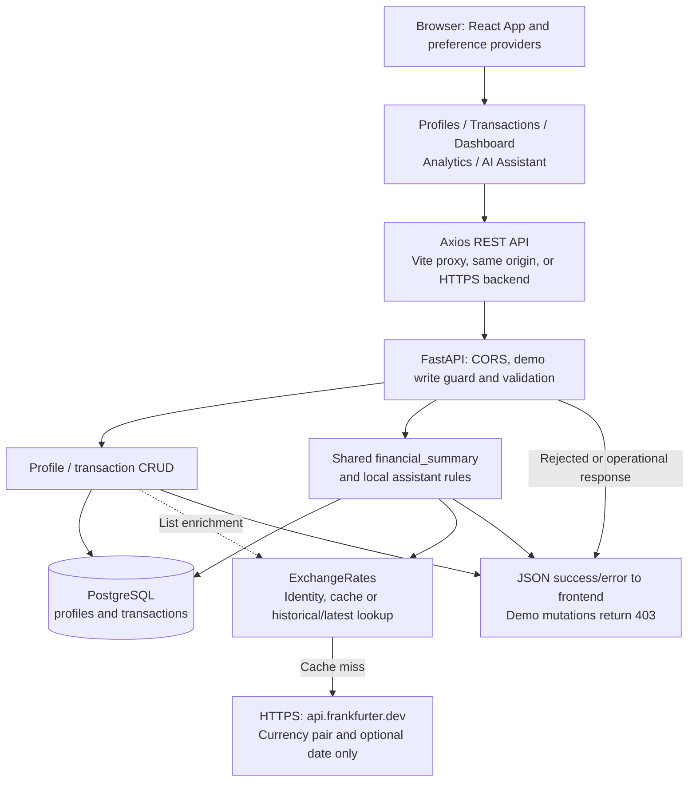

# FinFlow AI

A portfolio finance dashboard built with React, TypeScript, Vite, FastAPI,
SQLAlchemy, Alembic, and PostgreSQL. The public demo uses **fictional data only**
and is read-only. Local mode retains transaction editing and profile management.

## Features

- Dashboard and analytics with income, expenses, net balance, and category/month charts.
- Transaction search, filters, pagination, and local create/edit/delete workflows.
- Financial profiles, archive/restore, and combined reporting.
- USD, INR, and AED originals; historical conversion with publication-date evidence.
- Local rule-based assistant over aggregate financial summaries; no paid LLM or chat persistence.

Historical conversion rules are unchanged: transaction-date rates, or a prior
published rate within seven days; round each conversion before aggregation.
Missing required rates hide totals. Latest valuation is a separate, explicit choice.

## End-to-End Application Architecture

This vertical overview shows the implemented communication paths. See
[all 18 detailed application-flow diagrams](docs/APPLICATION_FLOW.md) for the
end-to-end flowcharts, request-response sequences, database diagram, endpoint
contracts, calculations, and failure paths.



Public demo mode blocks writes server-side. Local mode supports editing. The
assistant is rule-based and read-only; there is no external LLM integration.

## Existing local checkout

Use Python 3.13, Node 22.15.1+ on the Node 22 line (or Node 24), and PostgreSQL 17.
Keep your current `backend/.env` and virtual environment. **Do not run demo setup
against your existing database.** Neither launcher runs migrations or seeds data.

```powershell
cd backend
.\.venv\Scripts\python.exe -B run_dev.py
```

In another terminal:

```powershell
cd frontend
npm.cmd run dev
```

Frontend: <http://127.0.0.1:5173/>. API: <http://127.0.0.1:8000/>.
API docs: <http://127.0.0.1:8000/docs>.
Outbound HTTPS to `api.frankfurter.dev` is required for cross-currency reporting;
the backend must run in an environment that permits it.

## Reproducible installation and checks

For a fresh checkout, create a Python 3.13 virtual environment in `backend/.venv`,
then install exact dependency snapshots. On macOS/Linux replace
`.venv/Scripts/python.exe` with `.venv/bin/python` and `npm.cmd` with `npm`.

```powershell
cd backend
py -3.13 -m venv .venv
.\.venv\Scripts\python.exe -m pip install -r requirements-dev.lock
.\.venv\Scripts\python.exe -m pip check
.\.venv\Scripts\python.exe -B -m pytest tests -q
```

```powershell
cd frontend
npm.cmd ci
npm.cmd test -- --no-file-parallelism
npm.cmd run typecheck
npm.cmd run build
```

Production Python installation uses `backend/requirements.lock`; frontend
installation uses `npm ci` with the committed `package-lock.json`. Refresh locks
deliberately and rerun checks when dependencies change. The lock snapshots pin
versions, not package hashes or container-image digests.

Default backend tests use isolated SQLite and mocked rates. PostgreSQL migration
tests are opt-in and skipped unless the specially prepared restore-test database
is explicitly selected. Never point tests at the application database.

## Configuration and public-demo behavior

Examples contain no credentials. Copy `backend/.env.example` only for a new local
setup; do not overwrite an existing `.env`. Process environment overrides that
file. Production examples are templates, not automatically loaded files.

| Variable | Purpose |
| --- | --- |
| `APP_ENV` | `development` locally; production launcher forces `production`. |
| `FINFLOW_DEMO_MODE` | Server write guard; defaults to `false` locally and is required `true` in production. |
| `DB_HOST`, `DB_PORT`, `DB_NAME`, `DB_USER`, `DB_PASSWORD` | Server-only PostgreSQL configuration. Demo accepts `finflow_demo`, or `postgres` in an explicitly confirmed dedicated Supabase project. |
| `FINFLOW_SUPABASE_PROJECT_REF` | Required for Supabase demo `postgres`; matches the direct hostname or session-pooler username. Port 5432 and verified TLS are required. Omit for existing `finflow_demo` hosting. |
| `DB_SSLMODE`, `DB_SSLROOTCERT` | Production requires `verify-full`; system roots or a provider CA certificate. Existing local settings retain the previous `prefer` default. |
| `CORS_ORIGINS` | Comma-separated exact origins, without trailing slashes; HTTPS only in production. Empty for same-origin hosting. No wildcard origins. |
| `FINFLOW_SERVE_FRONTEND` | Serve built `frontend/dist` and SPA routes from FastAPI when `true`. |
| `PORT` | Production HTTP port; defaults to 8000. |
| `VITE_API_BASE_URL` | Public build-time frontend value: `/api` or `https://<backend-host>/api`. |
| `VITE_DEMO_MODE` | Set `true` for public builds to label fictional data and disable editing controls. Presentation only; the API guard is independent. |
| `API_PROXY_TARGET` | Vite development/preview proxy target; not embedded as a production reverse proxy. |
| `DEMO_DATABASE_URL` | One-time initializer only; never falls back to local `DB_*` settings. |

Demo mode denies all non-read HTTP methods server-side, including future routes,
except the existing read-only `POST /api/assistant/query`. Requests return 403
before database dependencies run. Normal local editing remains available when
demo mode is off. Profiles are not accounts or authorization boundaries.

`/api/config` exposes only the demo flag; `/api/health` is liveness;
`/api/readiness` verifies DB connectivity and revision `0003`.

## Deployment and repository preparation

See [DEPLOYMENT.md](DEPLOYMENT.md) for the Supabase -> Render -> Vercel setup,
isolated fictional seed data, verified TLS, CORS, and smoke checks. Cloud setup
and deployment require separate approval. Same-origin Docker hosting remains an alternative.
The Docker image serves React/Vite assets and FastAPI together; PostgreSQL remains
external. No build or startup command migrates or initializes any database.

Git ignore rules exclude environment files, credentials/keys, backups, database
dumps/files, caches, and build artifacts. Review `git status` and the staged diff
before the first commit. Never upload a local database backup for this demo.
The CI workflow runs checks only; it has no deployment job or credentials.

This is a portfolio reference application, not a service for real public
financial data. Public writes require a separate authentication and isolation
design before enabling them. Add hosting-level rate limits and spending limits
where available. See component notes in [backend/README.md](backend/README.md)
and [frontend/README.md](frontend/README.md).
